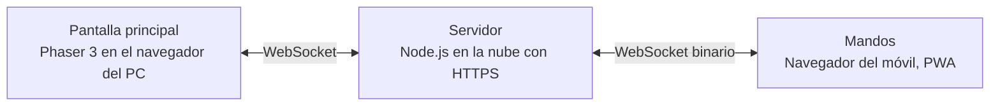

# PartyPad

Party game multijugador en el que la partida se ve en una pantalla grande y cada jugador usa **su propio móvil como mando**. Para unirse basta con escanear un código QR: no hay que instalar nada.

Proyecto de prácticas de **Multimedia** · Grado en Ingeniería Informática · ESI Ciudad Real (UCLM) · Curso 2026-27
Profesor: José Ramón Sánchez Palomares · Temática elegida: **Videojuego**

| | |
|---|---|
| **Equipo** | Daniel y Vicente · grupo de prácticas `16` |
| **Entrega** | 4 de diciembre de 2026, en Campus Virtual |
| **Presentación** | Entre el 9 y el 16 de diciembre, 15 minutos con demo en directo |

## Cómo funciona

1. El PC conectado al proyector abre PartyPad y crea una sala con un código de 4 letras y un QR.
2. Cada jugador escanea el QR con el móvil, elige nombre y color y aparece en el lobby (máximo 8).
3. Se juegan varias rondas de minijuegos cortos controlados con los sensores del móvil.
4. Al final se muestra un podio con la clasificación.

**Minijuegos:**

| Minijuego | Control | Disponible |
|---|---|---|
| Carrera de agitar | Acelerómetro: gana quien más agite el móvil | Incluido |
| Laberinto inclinable | Giroscopio: guiar una bola inclinando el móvil | Incluido |
| Reflejos | Táctil: pulsar el primero tras la señal; pulsar antes vibra como penalización | Incluido |
| Apunta y dispara | El móvil como puntero | Pack descargable |

## Arquitectura en un vistazo



El detalle está en [docs/02-arquitectura.md](docs/02-arquitectura.md).

## Documentación

| Documento | Contenido |
|---|---|
| [01 · Enunciado y requisitos](docs/01-enunciado.md) | Qué pide la asignatura, objetivos, requisitos funcionales y no funcionales, casos de uso |
| [02 · Arquitectura y diseño](docs/02-arquitectura.md) | Componentes, tecnologías, secuencias, estados de la partida, clases del servidor y sistema de packs |
| [03 · Protocolo y compresión](docs/03-protocolo.md) | Formato de los mensajes, protocolo binario y cómo medir la compresión para la memoria |
| [04 · Planificación y reparto](docs/04-planificacion.md) | Calendario semana a semana, quién hace qué, riesgos y forma de trabajar con Git |
| [05 · Memoria, entrega y presentación](docs/05-memoria-y-entrega.md) | Esqueleto de la memoria, contenido del ZIP de entrega y guion de la presentación |

Los diagramas también están como imagen en [`docs/diagramas/png`](docs/diagramas/png) (para pegarlos en la memoria) y como fuente Mermaid en [`docs/diagramas/fuentes`](docs/diagramas/fuentes) (para editarlos en [mermaid.live](https://mermaid.live)).

## Tecnologías

- **Servidor:** Node.js con Express y `ws`
- **Pantalla principal:** Phaser 3 y `qrcode`
- **Mando:** HTML, CSS y JavaScript con las APIs DeviceMotion/DeviceOrientation y Vibration, y un Service Worker
- **Red y compresión:** MessagePack y protocolo binario propio con `ArrayBuffer`
- **Despliegue:** Render, Railway o Fly.io

## Estructura prevista del repositorio

```text
partypad/
├── README.md
├── docs/                 Documentación y diagramas
├── server/               Servidor Node.js: salas, lógica, protocolo, packs
├── host/                 Pantalla principal: Phaser, lobby, minijuegos
├── controller/           Mando del móvil: PWA con sensores
├── shared/               Código común: protocolo de mensajes
└── packs/                Packs descargables y manifest.json
```

## Ejecución

Requiere Node.js 20 o superior. `npm install` instala todo lo necesario, también Phaser, que el servidor sirve a la pantalla desde `node_modules`: no hay que descargar ni copiar nada a mano.

```bash
npm install
npm run dev    # con túnel HTTPS: el móvil se conecta desde cualquier red
```

| Comando | Para qué |
|---|---|
| `npm run dev` | Desarrollo y pruebas con móviles. Abre un túnel de Cloudflare (sin cuenta) y el QR apunta a una URL pública `https://….trycloudflare.com`, así que funciona en cualquier red, también en la de la universidad, y no muestra la IP del ordenador. La URL cambia cada vez que se arranca. Reinicia el servidor al guardar cambios. |
| `npm run local` | Sin túnel ni internet. El mando solo se puede abrir desde el propio ordenador. |
| `npm start` | Despliegue. Si se define `PUBLIC_URL`, el QR apunta a ella. |

Abre la pantalla principal en `http://localhost:3000/` y escanea el QR con el móvil.

Para probar solo algunos minijuegos se pone su id en `MINIJUEGOS`, separados por comas: `MINIJUEGOS=laberinto npm run dev`.

Para probar sin móviles, `npm run simular` crea una sala y la juega entera con mandos falsos (bots) que se conectan por WebSocket como un móvil de verdad: agitan, buscan el camino en el laberinto y pulsan tras la señal. Con el servidor ya arrancado en otra terminal:

```bash
npm run simular -- --jugadores 8                 # contra http://localhost:3000
npm run simular -- --jugadores 4 --url https://….trycloudflare.com
npm run simular -- --jugadores 8 --quieto        # bots casi quietos, para ver el efecto de la compresión delta
```

Los sensores del móvil solo funcionan con HTTPS, así que para agitar de verdad hay que usar `npm run dev`. Sin sensor (por ejemplo, abriendo el mando en otra pestaña del PC para probar), tocar la pantalla muy rápido cuenta como agitar, y arrastrar el dedo por el círculo, como inclinar.

| Ruta | Qué sirve |
|---|---|
| `http://localhost:3000/` | Pantalla principal (`host/`) |
| `http://localhost:3000/mando` | Mando del móvil (`controller/`) |
| `/shared/…` | Código común (`shared/`) |
| `/packs/manifest.json` | Manifest de packs (`packs/`) |
| `/lib/phaser/…` | Phaser, desde `node_modules/phaser/dist` |

El puerto se cambia con la variable de entorno `PORT`.
