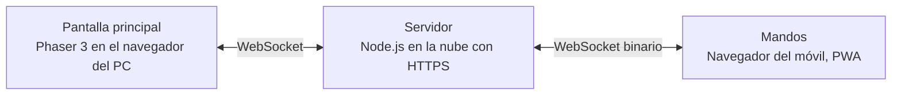

# PartyPad

Party game multijugador en el que la partida se ve en una pantalla grande y cada jugador usa **su propio móvil como mando**. Para unirse basta con escanear un código QR: no hay que instalar nada.

Proyecto de prácticas de **Multimedia** · Grado en Ingeniería Informática · ESI Ciudad Real (UCLM) · Curso 2026-27
Profesor: José Ramón Sánchez Palomares · Temática elegida: **Videojuego**

| | |
|---|---|
| **Equipo** | Daniel y Vicente · grupo de prácticas `16` |
| **Entrega** | 4 de diciembre de 2026, en Campus Virtual |
| **Presentación** | Entre el 9 y el 16 de diciembre, 15 minutos con demo en directo |

## Cómo funciona

1. El PC conectado al proyector abre PartyPad y crea una sala con un código de 4 letras y un QR.
2. Cada jugador escanea el QR con el móvil, elige nombre, avatar y color y aparece en el lobby (máximo 16).
3. Se juegan varias rondas de minijuegos cortos controlados con los sensores del móvil.
4. Al final se muestra un podio con la clasificación.

**Minijuegos:**

| Minijuego | Control | Disponible |
|---|---|---|
| Carrera de agitar | Acelerómetro: gana quien más agite el móvil | Incluido |
| Laberinto inclinable | Giroscopio: guiar una bola inclinando el móvil | Incluido |
| Reflejos | Táctil: pulsar el primero tras la señal; pulsar antes vibra como penalización | Incluido |
| Machaca el botón | Táctil: quien más veces pulse en 10 segundos | Incluido |
| Cronómetro a ciegas | Táctil: parar el reloj en 7,00 s, aunque se oculta a los 2,5 s | Incluido |
| Sumo | Giroscopio: echar a los demás de una plataforma que encoge | Incluido |
| Esquiva meteoritos | Giroscopio: apartarse de donde van a caer los meteoritos | Incluido |
| Quiz | 4 botones de colores: preguntas de cultura general, al estilo Kahoot | Incluido |
| Colores | 8 botones de colores: pulsar el color de la tinta, no el de la palabra | Incluido |
| Patata caliente | Táctil: pasar la bomba antes de que explote; a quien le explota, queda fuera | Incluido |
| Tira y afloja | Acelerómetro: dos equipos agitan para tirar de la cuerda | Incluido |
| Simón dice | 4 botones de colores: repetir una secuencia que crece cada nivel | Incluido |
| ¿Cuántos hay? | 4 botones de colores: recordar cuántos animales de un tipo había; cada vez más y durante menos tiempo | Incluido |
| Ritmo | Táctil: pulsar cuando las notas llegan a la línea, al ritmo de la melodía | Incluido |
| Dibuja | Lienzo táctil: todos dibujan lo mismo en el móvil, se ve en directo y se vota el mejor | Incluido |
| Apunta y dispara | El móvil como puntero | Pack descargable |

En cada partida los minijuegos salen en orden aleatorio y sin repetirse. En el lobby se elige cuántos: 3, 5 o todos.

## Arquitectura en un vistazo



El detalle está en [docs/02-arquitectura.md](docs/02-arquitectura.md).

## Documentación

| Documento | Contenido |
|---|---|
| [01 · Enunciado y requisitos](docs/01-enunciado.md) | Qué pide la asignatura, objetivos, requisitos funcionales y no funcionales, casos de uso |
| [02 · Arquitectura y diseño](docs/02-arquitectura.md) | Componentes, tecnologías, secuencias, estados de la partida, clases del servidor y sistema de packs |
| [03 · Protocolo y compresión](docs/03-protocolo.md) | Formato de los mensajes, protocolo binario y cómo medir la compresión para la memoria |
| [04 · Planificación y reparto](docs/04-planificacion.md) | Calendario semana a semana, quién hace qué, riesgos y forma de trabajar con Git |
| [05 · Memoria, entrega y presentación](docs/05-memoria-y-entrega.md) | Esqueleto de la memoria, contenido del ZIP de entrega y guion de la presentación |

Los diagramas también están como imagen en [`docs/diagramas/png`](docs/diagramas/png) (para pegarlos en la memoria) y como fuente Mermaid en [`docs/diagramas/fuentes`](docs/diagramas/fuentes) (para editarlos en [mermaid.live](https://mermaid.live)).

## Tecnologías

- **Servidor:** Node.js con Express y `ws`
- **Pantalla principal:** Phaser 3 y `qrcode`
- **Mando:** HTML, CSS y JavaScript con las APIs DeviceMotion/DeviceOrientation y Vibration, y un Service Worker
- **Red y compresión:** MessagePack y protocolo binario propio con `ArrayBuffer`
- **Despliegue:** Render, Railway o Fly.io

## Estructura prevista del repositorio

```text
partypad/
├── README.md
├── docs/                 Documentación y diagramas
├── server/               Servidor Node.js: salas, lógica, protocolo, packs
├── host/                 Pantalla principal: Phaser, lobby, minijuegos
├── controller/           Mando del móvil: PWA con sensores
├── shared/               Código común: protocolo de mensajes
├── scripts/              Simulador de jugadores y mediciones
└── packs/                Packs descargables y manifest.json
```

## Ejecución

Requiere Node.js 20 o superior. `npm install` instala todo lo necesario, también Phaser, que el servidor sirve a la pantalla desde `node_modules`: no hay que descargar ni copiar nada a mano.

```bash
npm install
npm run dev    # con túnel HTTPS: el móvil se conecta desde cualquier red
```

| Comando | Para qué |
|---|---|
| `npm run dev` | Desarrollo y pruebas con móviles. Abre un túnel de Cloudflare (sin cuenta) y el QR apunta a una URL pública `https://….trycloudflare.com`, así que funciona en cualquier red, también en la de la universidad, y no muestra la IP del ordenador. La URL cambia cada vez que se arranca. Reinicia el servidor al guardar cambios. |
| `npm run local` | Sin túnel ni internet. El mando solo se puede abrir desde el propio ordenador. |
| `npm start` | Despliegue. Si se define `PUBLIC_URL`, el QR apunta a ella. |

Abre la pantalla principal en `http://localhost:3000/` y escanea el QR con el móvil.

Para probar solo algunos minijuegos se pone su id en `MINIJUEGOS`, separados por comas: `MINIJUEGOS=laberinto npm run dev`.

Para probar sin móviles, `npm run simular` crea una sala y la juega entera con mandos falsos (bots) que se conectan por WebSocket como un móvil de verdad: agitan, buscan el camino en el laberinto y pulsan tras la señal. Con el servidor ya arrancado en otra terminal:

```bash
npm run simular -- --jugadores 8                 # contra http://localhost:3000
npm run simular -- --jugadores 4 --url https://….trycloudflare.com
npm run simular -- --jugadores 8 --quieto        # bots casi quietos, para ver el efecto de la compresión delta
```

Los sensores del móvil solo funcionan con HTTPS, así que para agitar de verdad hay que usar `npm run dev`. Sin sensor (por ejemplo, abriendo el mando en otra pestaña del PC para probar), tocar la pantalla muy rápido cuenta como agitar, y arrastrar el dedo por el círculo, como inclinar.

| Ruta | Qué sirve |
|---|---|
| `http://localhost:3000/` | Pantalla principal (`host/`) |
| `http://localhost:3000/mando` | Mando del móvil (`controller/`) |
| `/shared/…` | Código común (`shared/`) |
| `/packs/manifest.json` | Manifest de los packs publicados, que el servidor genera a partir de `packs/` |
| `/packs/<id>-<versión>.zip` | El ZIP de cada pack |
| `/lib/phaser/…` y `/lib/fflate/…` | Phaser y fflate (para descomprimir los packs), desde `node_modules` |
| `/medidas` | Mediciones de red de cada ronda: compresión y latencia (ver [03 · Protocolo](docs/03-protocolo.md#cómo-se-mide)) |
| `/api/medidas.csv` | Las mismas mediciones en CSV |

`npm run medir` juega partidas con 2, 4 y 8 bots contra un servidor propio y deja las tablas de compresión en [`docs/mediciones/bots.md`](docs/mediciones/bots.md), listas para la memoria.

El puerto se cambia con la variable de entorno `PORT`.

### El mando como PWA

El mando se puede instalar en el móvil («Añadir a pantalla de inicio») y se abre como una app. Su Service Worker ([`controller/sw.js`](controller/sw.js)) guarda en caché los archivos del mando con un número de versión que calcula el servidor (un hash de esos archivos): al cambiar cualquiera, los móviles descargan la versión nueva y borran la anterior. Con `NODE_ENV=production` (el despliegue) el mando se sirve primero de la caché y carga al instante; en desarrollo va primero a la red, para ver cada cambio al recargar. Solo funciona con HTTPS o en `localhost`.

### Packs descargables

Cada carpeta de [`packs/`](packs) con un `pack.json` es un minijuego descargable (ver [02 · Sistema de packs](docs/02-arquitectura.md#sistema-de-packs-descarga-y-actualización)). **Apunta y dispara** arranca sin publicar, para poder publicarlo en directo con el servidor en marcha:

```bash
npm run publicar -- apunta                       # en http://localhost:3000
npm run publicar -- apunta --retirar
npm run publicar -- apunta --url https://partypad.onrender.com --token <ADMIN_TOKEN>
```

Las pantallas abiertas lo descargan al momento, comprueban su SHA-256, lo guardan en IndexedDB (no se vuelve a descargar al recargar) y lo añaden a la partida. Para que salga publicado siempre, se pone `"publicado": true` en su `pack.json`.

## Despliegue en la nube

Para la demo y para probar en la red de la universidad conviene tenerlo desplegado: HTTPS (obligatorio para los sensores) y una URL fija que no cambia en cada arranque. El servidor no necesita configuración: la URL del QR se saca de la dirección con la que se abre la pantalla, también detrás del proxy HTTPS del despliegue.

**Render (recomendado, gratis):**

1. Entrar en [render.com](https://render.com) con la cuenta de GitHub.
2. *New → Blueprint* y elegir este repositorio. Render lee [`render.yaml`](render.yaml) y crea el servicio `partypad`.
3. Al terminar, la pantalla está en `https://partypad.onrender.com` (o el nombre que asigne Render) y el mando en `/mando`. Cada push a `main` se despliega solo.

Render genera un `ADMIN_TOKEN` (se ve en *Environment* del servicio): es el que pide `npm run publicar` para publicar packs en el despliegue.

En el plan gratuito, el servidor se duerme tras 15 minutos sin uso y tarda alrededor de un minuto en despertar: antes de la demo hay que abrir la pantalla con tiempo. Las salas viven en memoria, así que un despliegue nuevo las cierra.

**Otras opciones:** el [`Dockerfile`](Dockerfile) sirve para Fly.io (`fly launch` y `fly deploy`) o Railway (*New project → Deploy from GitHub*). En los dos casos el servidor escucha en el `PORT` que le den.

Render comprueba que el servidor está arrancado con `/salud`.
