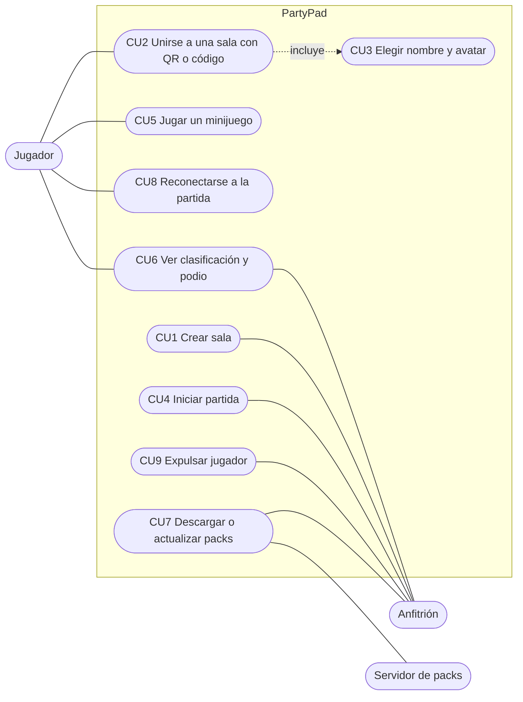

# 01 · Enunciado y requisitos

[← Volver al README](../README.md)

## Qué pide la asignatura

Desarrollar una **aplicación multimedia** sobre uno de estos temas: vídeo interactivo, reproductor audiovisual, **videojuego**, compresores, reconocimiento y análisis de señales, o una propuesta propia. Hemos elegido **videojuego**.

La aplicación debe contemplar al menos estos aspectos:

- Descarga y actualización
- Comunicación
- Visualización y/o reproducción
- Interacción con el usuario y/o con otros sistemas hardware o software
- Compresión

Además debe estar **bien empaquetada y ser completamente funcional**, con la mínima necesidad de instalar otras cosas. El tipo de aplicación (móvil, web, escritorio, IoT, servicio…) lo elegimos nosotros.

**Lo que se valora positivamente:**

- La iniciativa y el nivel de complejidad de la solución
- Hacer preguntas en las presentaciones de los compañeros
- Hacer una demo durante la presentación
- La integración con otras soluciones y herramientas
- El uso de APIs y librerías externas específicas
- La interactividad

**Peso en la nota:** las prácticas de laboratorio son el **25 %** de la nota final, tanto en evaluación continua como no continua. Es una actividad obligatoria y recuperable.

## Descripción del proyecto

PartyPad es una aplicación web multijugador de minijuegos. La partida se muestra en una pantalla principal (PC o proyector) y cada jugador usa su móvil como mando. Para unirse basta con escanear un QR. El mando usa el acelerómetro, el giroscopio, la pantalla táctil y la vibración del móvil. La partida consiste en varias rondas de minijuegos cortos con puntuación acumulada y un podio final.

## Objetivos

- Desarrollar un videojuego multijugador en tiempo real que se pueda jugar desde cualquier móvil.
- Integrar hardware externo (los sensores del móvil) como sistema de control.
- Diseñar un sistema de contenidos descargables para añadir minijuegos sin reinstalar nada.
- Estudiar y medir técnicas de compresión aplicadas a la red y a los recursos multimedia.

## Cómo cumplimos los cinco aspectos obligatorios

| Aspecto | Cómo se cumple | Dónde se detalla |
|---|---|---|
| Descarga y actualización | Manifest de packs versionados en el servidor. La pantalla principal descarga los packs nuevos sin reiniciar. El mando es una PWA con caché versionada. | [02 · Sistema de packs](02-arquitectura.md#sistema-de-packs-descarga-y-actualización) |
| Comunicación | WebSockets en tiempo real entre pantalla, servidor y mandos, organizados por salas | [02 · Arquitectura](02-arquitectura.md) |
| Visualización y reproducción | Renderizado 2D con Phaser, música, efectos de sonido, animaciones y podio | [02 · Componentes](02-arquitectura.md#componentes) |
| Interacción con usuario y hardware | Sensores de movimiento, pantalla táctil y vibración del móvil | [02 · Componentes](02-arquitectura.md#componentes) |
| Compresión | Comparativa del protocolo de red (JSON, MessagePack, binario propio con cuantización y compresión delta) y de los recursos de los packs (PNG frente a WebP, MP3 frente a Opus) | [03 · Protocolo y compresión](03-protocolo.md) |

## Requisitos funcionales

| Id | Requisito |
|---|---|
| RF1 | La pantalla principal crea una sala con un código de 4 letras y un QR de acceso. |
| RF2 | Los jugadores se unen desde el navegador del móvil, eligen nombre y avatar y aparecen en el lobby (máximo 16). |
| RF3 | El anfitrión inicia la partida, que consta de varias rondas de minijuegos. |
| RF4 | Incluye de base nueve minijuegos (Carrera de agitar, Laberinto inclinable, Reflejos, Machaca, Cronómetro, Sumo, Esquiva, Quiz y Colores), que se juegan en orden aleatorio. |
| RF5 | Un cuarto minijuego, Apunta y dispara, se distribuye como pack descargable. |
| RF6 | Hay puntuación por ronda, clasificación acumulada y podio final. |
| RF7 | Si un jugador se desconecta, puede volver a la partida durante 30 segundos con su token de reconexión. |
| RF8 | Funciona en Android e iOS, con una alternativa cuando un sensor o la vibración no estén disponibles. |
| RF9 | El anfitrión puede pausar la partida y expulsar jugadores. |

## Requisitos no funcionales

| Id | Requisito |
|---|---|
| RNF1 | Latencia percibida inferior a 100 ms entre la acción en el móvil y la reacción en pantalla. |
| RNF2 | Instalación mínima: accesible por una URL pública con HTTPS, y ejecución local con `npm install && npm start`. |
| RNF3 | La interfaz del mando se puede usar con una mano y en vertical. |
| RNF4 | Soporta 16 jugadores simultáneos por sala sin pérdida apreciable de fluidez. |

## Casos de uso

| Caso de uso | Actor | Descripción |
|---|---|---|
| CU1 Crear sala | Anfitrión | Abre PartyPad en el PC y obtiene un código y un QR. |
| CU2 Unirse a una sala | Jugador | Escanea el QR o escribe el código en el móvil. Incluye CU3. |
| CU3 Elegir nombre y avatar | Jugador | Personaliza su jugador antes de entrar en el lobby. |
| CU4 Iniciar partida | Anfitrión | Empieza la partida cuando hay al menos 2 jugadores. |
| CU5 Jugar un minijuego | Jugador | Controla su personaje con el móvil durante la ronda. |
| CU6 Ver clasificación y podio | Ambos | Resultados tras cada ronda y podio al final. |
| CU7 Descargar o actualizar packs | Anfitrión | Obtiene minijuegos nuevos del servidor de packs. |
| CU8 Reconectarse | Jugador | Vuelve a la partida tras perder la conexión. |
| CU9 Expulsar jugador | Anfitrión | Saca a un jugador de la sala. |
