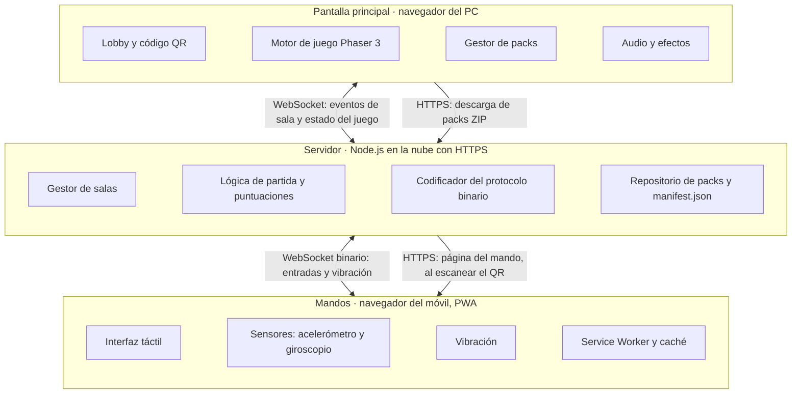
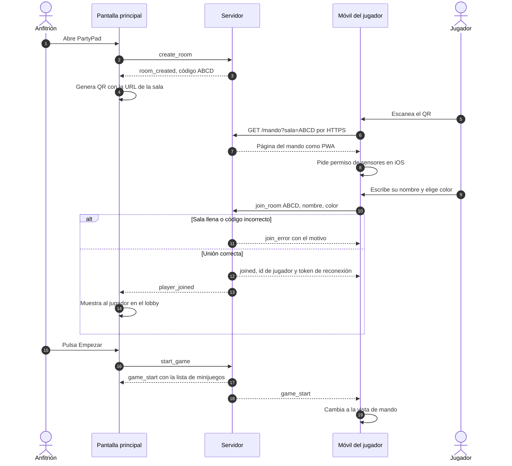
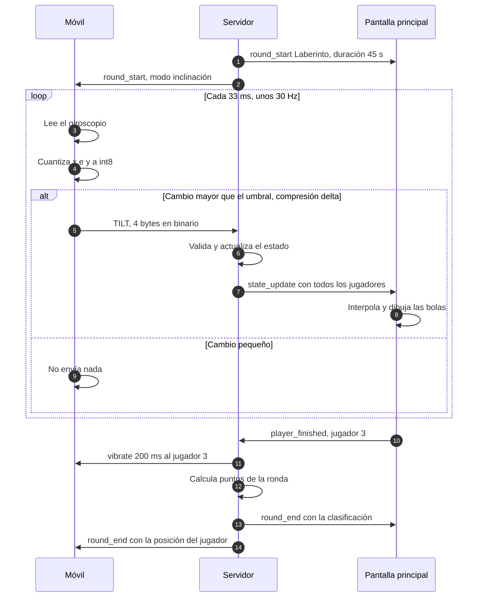
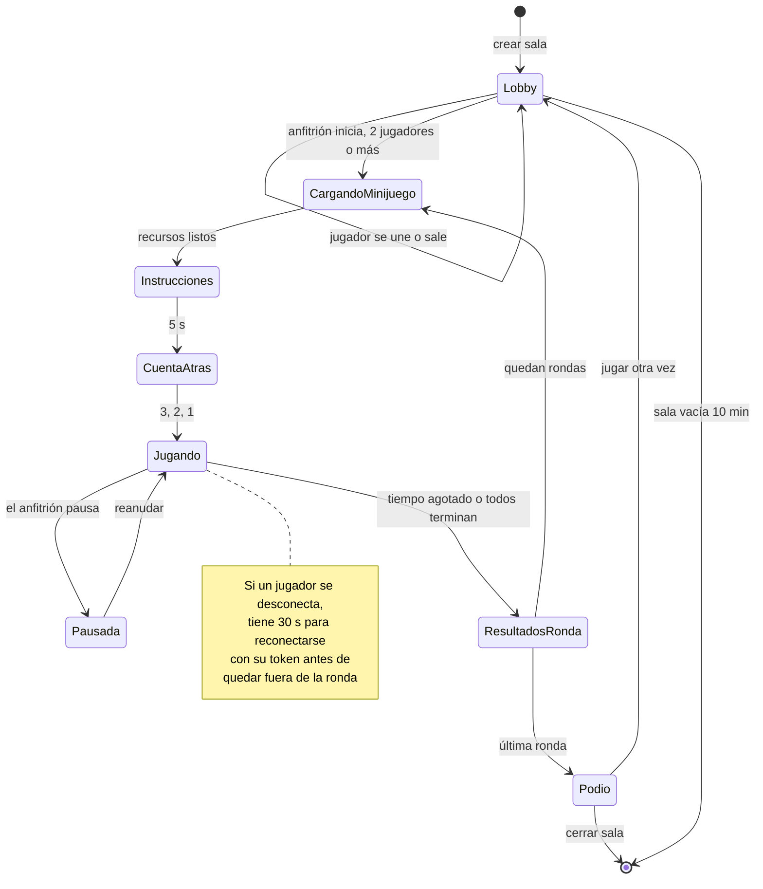
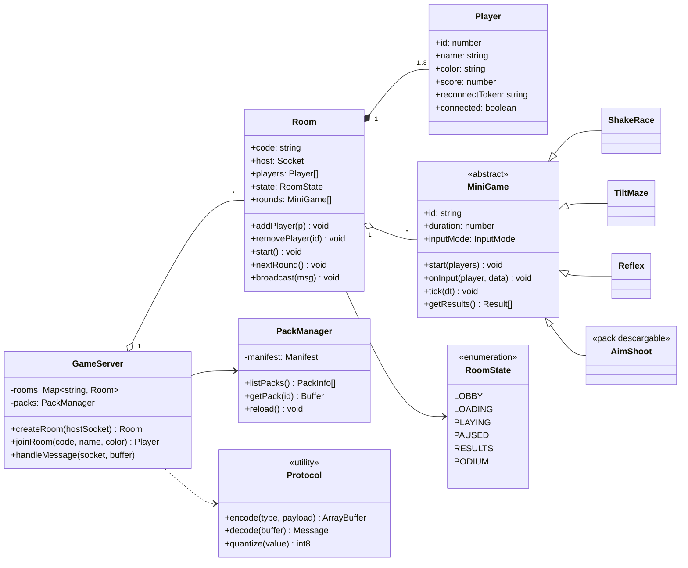
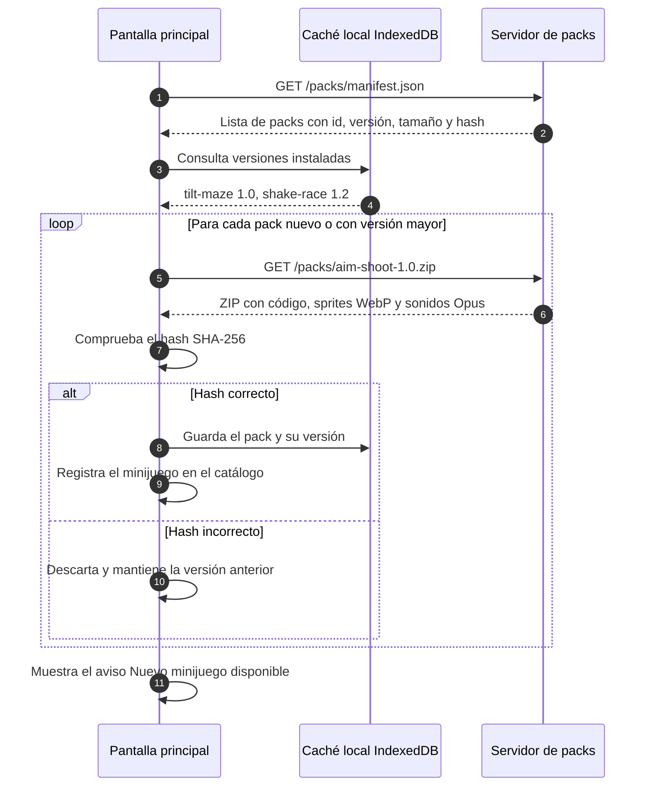

# 02 · Arquitectura y diseño

[← Volver al README](../README.md)

## Visión general

PartyPad tiene tres piezas: la **pantalla principal**, el **servidor** y los **mandos**. El servidor es el único punto de contacto: la pantalla y los móviles nunca hablan directamente entre sí. Así funciona aunque la wifi de la universidad aísle los dispositivos, y además el servidor en la nube nos da HTTPS, que es **obligatorio** para que el navegador del móvil deje leer los sensores.



## Componentes

### Pantalla principal (`host/`)

Página web que se abre en el PC conectado al proyector.

- **Lobby y QR:** muestra el código de la sala, el QR (librería `qrcode`) y los jugadores que se van uniendo.
- **Motor de juego:** cada minijuego es una escena de Phaser 3. Dibuja a los jugadores, interpola sus movimientos para que no den tirones y muestra resultados y podio.
- **Gestor de packs:** consulta el manifest del servidor, descarga los packs nuevos y los guarda en IndexedDB.
- **Audio:** música de fondo y efectos de sonido de cada minijuego.

### Servidor (`server/`)

Node.js con Socket.IO o `ws`, desplegado en Render, Railway o Fly.io.

- **Gestor de salas:** crea salas, asigna códigos, gestiona altas, bajas y reconexiones.
- **Lógica de partida:** lleva la máquina de estados de cada sala, el orden de los minijuegos y las puntuaciones.
- **Protocolo:** codifica y decodifica los mensajes binarios de los mandos (ver [03 · Protocolo](03-protocolo.md)).
- **Repositorio de packs:** sirve `manifest.json` y los ZIP de los packs.

### Mando (`controller/`)

Página web móvil que se abre al escanear el QR. Se instala como PWA para que cargue rápido.

- **Interfaz táctil:** botones grandes, usable con una mano y en vertical.
- **Sensores:** `DeviceMotionEvent` (acelerómetro) y `DeviceOrientationEvent` (giroscopio).
- **Vibración:** `navigator.vibrate()` para avisos y penalizaciones.
- **Service Worker:** guarda en caché los recursos del mando con un número de versión.

## Tecnologías y por qué las elegimos

| Tecnología | Uso | Motivo |
|---|---|---|
| Node.js | Servidor | JavaScript en las tres partes: podemos compartir el código del protocolo en `shared/`. |
| Socket.IO o `ws` | Tiempo real | WebSockets con salas y reconexión. `ws` permite enviar binario puro sin sobrecoste. |
| Phaser 3 | Pantalla principal | Motor 2D maduro para navegador: escenas, físicas, sprites y audio. |
| `qrcode` | Lobby | Genera el QR en el navegador sin servicios externos. |
| APIs de sensores del navegador | Mando | El móvil no necesita ninguna app instalada. |
| MessagePack | Comparativa | Formato binario genérico para comparar con JSON y con nuestro protocolo. |
| Render / Railway / Fly.io | Despliegue | HTTPS gratis y URL pública para la demo. |

## Secuencia: unirse a una sala

Desde que se abre PartyPad hasta que empieza la partida. Incluye el permiso de sensores que exige iOS y el token de reconexión que recibe cada jugador.



## Secuencia: bucle de juego en tiempo real

Una ronda del Laberinto. El móvil lee el giroscopio unas 30 veces por segundo, pero **solo envía cuando el cambio supera un umbral** (compresión delta), y cada envío ocupa 4 bytes.



## Estados de la partida

La máquina de estados que gestiona el servidor para cada sala. Corresponde al enumerado `RoomState` del diagrama de clases.



| Estado | Qué ocurre |
|---|---|
| Lobby | Los jugadores entran y salen. El anfitrión espera a tener al menos 2. |
| CargandoMinijuego | La pantalla carga los recursos del siguiente minijuego. |
| Instrucciones | Se explica el minijuego durante 5 segundos, en pantalla y en el móvil. |
| CuentaAtras | 3, 2, 1. |
| Jugando | Los mandos envían entradas y el servidor actualiza el estado. |
| Pausada | El anfitrión ha pausado. Los mandos dejan de enviar. |
| ResultadosRonda | Puntos de la ronda y clasificación acumulada. |
| Podio | Clasificación final. Se puede volver a jugar o cerrar la sala. |

## Clases del servidor

Cada minijuego hereda de `MiniGame`. Por eso un pack descargable como `AimShoot` se añade sin tocar el resto del código: basta con implementar `start`, `onInput`, `tick` y `getResults`.



## Sistema de packs: descarga y actualización

Cada pack es un ZIP con el código del minijuego, los sprites en WebP y los sonidos en Opus. El servidor publica un `manifest.json` con la lista de packs disponibles:

```json
{
  "version": 3,
  "packs": [
    { "id": "shake-race", "name": "Carrera de agitar",  "version": "1.2.0", "size": 184320, "sha256": "…" },
    { "id": "tilt-maze",  "name": "Laberinto",          "version": "1.0.0", "size": 256000, "sha256": "…" },
    { "id": "reflex",     "name": "Reflejos",           "version": "1.0.0", "size": 98304,  "sha256": "…" },
    { "id": "aim-shoot",  "name": "Apunta y dispara",   "version": "1.0.0", "size": 312000, "sha256": "…" }
  ]
}
```

Al arrancar, la pantalla principal compara el manifest con lo que tiene en su caché y descarga solo lo nuevo o actualizado, comprobando el hash antes de instalarlo.



**Para la demo:** empezamos la presentación con tres minijuegos, publicamos `aim-shoot` en el servidor en directo y la pantalla lo detecta y lo descarga. Así se ve el requisito de actualización funcionando.
