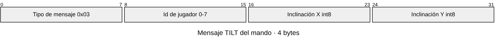

# 03 · Protocolo y compresión

[← Volver al README](../README.md)

La compresión es el aspecto obligatorio que más fácil se queda flojo en un videojuego, así que la hacemos **explícita y medida**. Hay dos frentes: los mensajes de red y los recursos de los packs.

## Dos tipos de mensajes

| Tipo | Ejemplos | Frecuencia | Formato |
|---|---|---|---|
| Entradas de los mandos | Inclinación, agitado, botones | Hasta 30 por segundo y jugador | **Binario propio** |
| Eventos de sala | `create_room`, `joined`, `round_start`, `round_end` | Pocos por minuto | **JSON**, porque se lee y depura mejor y el tamaño no importa |

Esta separación es una decisión de diseño que se justifica en la memoria: comprimimos donde el volumen lo justifica y dejamos legible el resto.

## Mensajes binarios

El primer byte siempre es el tipo de mensaje. El código de estos mensajes va en `shared/` para que lo usen igual el servidor, la pantalla y el mando.

| Código | Mensaje | Sentido | Tamaño | Contenido |
|---|---|---|---|---|
| `0x02` | BUTTON | Mando → servidor | 3 bytes | Tipo, jugador, botón (bits 1-7) y estado (bit 0: 1 pulsado, 0 soltado) |
| `0x03` | TILT | Mando → servidor | 4 bytes | Tipo, jugador, X e Y cuantizados a `int8` |
| `0x04` | SHAKE | Mando → servidor | 3 bytes | Tipo, jugador, intensidad `uint8` |
| `0x10` | VIBRATE | Servidor → mando | 4 bytes | Tipo, jugador, duración en ms (`uint16`) |

El código `0x01` queda libre: unirse a una sala ocurre una vez por jugador, así que va en JSON como el resto de eventos de sala.

El servidor es quien asigna el id de cada jugador y se lo comunica al mando con el evento JSON `joined`. Las entradas de los mandos no llegan a la pantalla: las procesa la partida en el servidor, que **ignora el byte de jugador y usa el id de la conexión**, para que un mando no pueda hacerse pasar por otro.

### Ejemplo: mensaje TILT



El giroscopio da valores decimales entre -1 y 1. Los **cuantizamos** a un entero de 8 bits multiplicando por 127 y redondeando:

| Campo | Valor original | Cuantizado | Byte |
|---|---|---|---|
| Tipo | TILT | 3 | `03` |
| Jugador | 3 | 3 | `03` |
| X | 0,2345 | 30 | `1E` |
| Y | −0,8812 | −112 | `90` |

Mensaje completo: `03 03 1E 90`.

La cuantización pierde precisión (pasamos de unos 7 decimales a 255 niveles), pero un paso de 1/127 de inclinación es imperceptible en el juego.

```js
// shared/protocol.js (borrador)
export const MSG = { BUTTON: 0x02, TILT: 0x03, SHAKE: 0x04, VIBRATE: 0x10 };

const quantize = (v) => Math.max(-127, Math.min(127, Math.round(v * 127)));

export function encodeTilt(player, x, y) {
  const view = new DataView(new ArrayBuffer(4));
  view.setUint8(0, MSG.TILT);
  view.setUint8(1, player);
  view.setInt8(2, quantize(x));
  view.setInt8(3, quantize(y));
  return view.buffer;
}

export function decode(buffer) {
  const view = new DataView(buffer);
  switch (view.getUint8(0)) {
    case MSG.TILT:
      return { type: 'tilt', player: view.getUint8(1), x: view.getInt8(2) / 127, y: view.getInt8(3) / 127 };
    // … resto de mensajes
  }
}
```

## Eventos de sala (JSON)

Cada conexión indica qué es al abrir el WebSocket: `/ws?rol=pantalla` o `/ws?rol=mando`. Todos los mensajes llevan un campo `type`.

**Pantalla → servidor**

| Mensaje | Campos | Qué hace |
|---|---|---|
| `create_room` | | Crea una sala nueva |
| `resume_room` | `code`, `token` | Recupera la sala tras recargar la página |
| `start_game` | `rounds` (opcional) | Empieza la partida (2 jugadores o más) con `rounds` minijuegos al azar y sin repetir; sin `rounds`, todos. También desde el podio, para jugar otra vez |
| `back_to_lobby` | | Vuelve al lobby |
| `kick` | `id` | Expulsa a un jugador |
| `close_room` | | Cierra la sala |
| `packs_installed` | `ids` | Los packs que la pantalla ya ha descargado; solo esos entran en su partida |

**Servidor → pantalla**

| Mensaje | Campos | Cuándo |
|---|---|---|
| `room_created` | `code`, `token` | Sala creada; el token sirve para `resume_room` |
| `room_resumed` | `code`, `state`, `players` | Sala recuperada |
| `resume_error` | | El código o el token no valen |
| `player_joined` | `player` (`id`, `name`, `color`, `avatar`, `connected`) | Entra un jugador |
| `player_status` | `id`, `connected` | Un jugador se desconecta o vuelve |
| `player_left` | `id` | Un jugador sale, es expulsado o no vuelve a tiempo |
| `minigames` | `list` (`id`, `name`, `instructions`, `control`, `clock`) | Al crear o recuperar la sala y tras `packs_installed`: los minijuegos de la partida |
| `packs_updated` | `version` | Hay un pack nuevo o actualizado en el manifest: la pantalla vuelve a sincronizar |

**Mando → servidor**

| Mensaje | Campos | Qué hace |
|---|---|---|
| `room_info` | `code` | Consulta la sala antes de unirse; mientras elige, recibe los cambios de avatares libres |
| `join_room` | `code`, `name`, `avatar`, `color` | Se une. El nombre tiene como máximo 16 caracteres; el avatar es un índice de `shared/avatares.js` y el color, de `shared/colores.js`. Ninguno de los dos se puede repetir en la sala; sin color, el servidor da el primero libre |
| `rejoin` | `code`, `token` | Vuelve con el token guardado en el móvil |
| `leave_room` | | Sale de la sala |
| `input_stats` | `samples`, `sent` | Al dejar de leer el sensor: lecturas tomadas y mensajes enviados, para medir la compresión delta |

**Servidor → mando**

| Mensaje | Campos | Cuándo |
|---|---|---|
| `room_info` | `code`, `exists`, `state`, `full`, `takenAvatars`, `takenColors` | Respuesta a `room_info` y cambios de avatares o colores |
| `joined` | `code`, `token`, `state`, `hostConnected`, `player` | Unión o reconexión correcta |
| `join_error` | `reason`: `not_found`, `started`, `full`, `invalid_name`, `invalid_avatar`, `avatar_taken`, `invalid_color`, `color_taken` | No se ha podido unir |
| `rejoin_error` | | El token ya no vale; hay que unirse como jugador nuevo |
| `host_status` | `connected` | La pantalla se desconecta o vuelve |
| `kicked` | | El anfitrión lo ha expulsado |

**Servidor → pantalla y mandos:** `game_start` (con `rounds`, la lista de minijuegos), `back_to_lobby` y `room_closed`.

### Mensajes de la partida

La partida la lleva el servidor (`server/partida.js`). Cada ronda pasa por cuatro fases y, tras la última, llega el podio. Al cambiar de fase, el servidor avisa a la pantalla y a cada mando; si alguien se reconecta a mitad, le vuelve a mandar la fase en la que está.

| Fase | Mensaje | Duración |
|---|---|---|
| Instrucciones | `round_intro` | 5 s |
| Cuenta atrás | `countdown` | 3 s |
| Jugando | `round_start` y, a la pantalla, `state_update` cada 100 ms (50 ms en el Laberinto; en Reflejos, en cuanto cambia algo y si no cada segundo) | Lo que diga el minijuego |
| Resultados | `round_end` | 8 s |
| Podio | `podium` | Hasta que el anfitrión juega otra vez o vuelve al lobby |

Los cuatro mensajes de ronda llevan `round`, `rounds`, `minigame` (`id`, `name`, `instructions`, `control`) y `ms`, el tiempo que le queda a la fase. `control` dice al mando qué mostrar: `agitar`, `inclinar`, `tocar`, `opciones` (4 botones de colores, con el número de botón de 0 a 3 en BUTTON) o `apuntar`. Con `clock: false` la pantalla no enseña el tiempo que queda (el Cronómetro). En `apuntar` (el pack Apunta y dispara), el mando manda la posición de la mirilla con el mismo mensaje TILT (de -1 a 1 en cada eje, 0 en el centro) y los disparos con BUTTON.

A la pantalla, además, le llegan en todos ellos `setup` (lo que no cambia en la ronda, como el mapa del laberinto, o `null`) y el estado del minijuego. Así puede dibujarlo desde las instrucciones o al recargar a mitad, sin mandar el mapa en cada `state_update`.

| Mensaje | Además, a la pantalla | Además, al mando |
|---|---|---|
| `round_start` | El estado inicial del minijuego | |
| `state_update` | `ms` y el estado del minijuego. En la Carrera de agitar: `players` con `id`, `progress` (0 a 1), `intensity` y `place` (0 si aún no ha llegado). En el Laberinto: `players` con `id`, `x`, `y` (en celdas) y `place`. En Reflejos: `phase` (`preparados`, `espera`, `ya` o `pausa`), `signal` (de 1 a `signals`), `signals`, `winner` (el más rápido de la última señal, o `null`) y `players` con `id`, `ms` (tiempo en la señal actual o `null`), `early`, `missed` y `total` (ms acumulados). En Apunta y dispara: `players` con `id`, `x`, `y` (la mirilla, con el campo de `setup.width` × 1) y `score`; `targets` con `n`, `x`, `y`, `r`, `gold` y `life` (de 1 a 0); y `shots`, los disparos del último medio segundo, con `n`, `id`, `x`, `y`, `diana` (la acertada o `null`) y `puntos` | |
| `round_end` | `last`, `results` (`id`, `place`, `points`) y `ranking` (`id`, `place`, `total`) | `place`, `points`, `total` y `overall` (puesto en la general) |
| `podium` | `ranking` | `place` y `total` |
| `finished` | | `place`, al llegar a la meta (junto con un VIBRATE de 300 ms), y otra vez si se reconecta después de llegar |
| `reflex_wait` | | `signal` y `signals`, al empezar cada señal de Reflejos (y al reconectarse a mitad) |
| `reaction` | | Tras pulsar en Reflejos: `ms`, o `early: true` (antes de la señal, con un VIBRATE de 400 ms y `ms` de penalización) o `missed: true` (no pulsó a tiempo) |

Los puntos por puesto en cada ronda son 15, 12, 10, 8, 7, 6, 5, 4, 3, 2 y 1; del 12º en adelante, 0. Los empatados comparten puesto y puntos.

**Avisos al mando (`hint`):** los minijuegos nuevos le dicen al mando qué enseñar con `hint`: `title`, `text`, `mood` (`bien`, `mal` o nada) y `lock` (si se bloquean o desbloquean los botones). Por ejemplo, el número de pregunta del Quiz, «¡Parado!» en el Cronómetro o «¡Te han echado!» en el Sumo.

**Estado de los minijuegos nuevos** (además de `ms`):

| Minijuego | `state_update` |
|---|---|
| Machaca | `players` con `id` y `taps` |
| Cronómetro | `target`, `time`, `hidden` (el reloj ya no se ve), `done` (se descubren los tiempos) y `players` con `id`, `stopped` y `at` (el tiempo, solo con `done`) |
| Sumo | `radius` (el de la plataforma, que encoge) y `players` con `id`, `x`, `y` y `out` |
| Esquiva | `players` con `id`, `x`, `y` y `out`; `meteors` con `n`, `x`, `y`, `r` y `t` (de 0 a 1 hasta el impacto); e `impacts` con `n`, `x`, `y` y `r` |
| Quiz | `phase` (`pregunta` o `respuesta`), `turn`, `turns`, `question`, `options`, `correct` (solo en `respuesta`) y `players` con `id`, `answered`, `choice`, `gained` (solo en `respuesta`) y `points` |
| Colores | Lo mismo que el Quiz, pero con `word` (la palabra) e `ink` (el color de la tinta: el índice del botón correcto) en lugar de la pregunta |

**Reflejos:** se juegan 5 señales. Antes de cada una hay una espera al azar de 1,5 a 4,5 s; luego hay 1,5 s para pulsar y 2,5 s mostrando los tiempos. Gana quien menos tiempo suma: pulsar antes de la señal suma 2 s y no pulsar, 1,5 s. El servidor mide el tiempo desde que manda la señal a la pantalla (sin esperar al siguiente `state_update`) hasta que le llega el BUTTON. La señal solo aparece en la pantalla grande, así que su retraso es el mismo para todos y la diferencia entre jugadores solo depende de la subida de cada móvil.

**Reglas de la sala:** el código tiene 4 letras sin I ni O, para no confundirlas con 1 y 0. Caben 16 jugadores, cada uno con un avatar y un color distintos. Un mando desconectado en el lobby conserva su sitio 30 segundos; durante la partida lo conserva siempre. Una sala sin pantalla se cierra a los 10 minutos. El servidor manda un ping de WebSocket a cada conexión cada 15 segundos y cierra la que no ha contestado al anterior: así detecta un móvil que se queda sin red sin cerrar la conexión, y el túnel o el proxy del despliegue no cortan las conexiones que pasan un rato sin mensajes.

## Compresión delta

El mando lee el sensor unas 30 veces por segundo, pero si el jugador tiene el móvil quieto no tiene sentido enviar el mismo valor una y otra vez. Solo enviamos cuando el valor cuantizado cambia más que un umbral:

```js
let last = { x: 0, y: 0 };
const UMBRAL = 2; // en unidades cuantizadas

function onSensor(x, y) {
  const qx = quantize(x), qy = quantize(y);
  if (Math.abs(qx - last.x) >= UMBRAL || Math.abs(qy - last.y) >= UMBRAL) {
    socket.send(encodeTilt(myId, x, y));
    last = { x: qx, y: qy };
  }
}
```

El umbral es un compromiso: más alto ahorra más datos pero el movimiento se nota más "a saltos". Conviene probar varios valores y elegir uno.

En el mando real (`controller/sensores.js`) la inclinación se lee como mucho cada 33 ms y el umbral es de 2 unidades cuantizadas. La agitación se lee cada 50 ms y solo se envía si la intensidad cambia al menos 0,04. En el Laberinto, la postura con la que se empieza cuenta como plana, y el botón «Recalibrar» la vuelve a tomar. La inclinación no se calcula restando ángulos, sino con el vector de gravedad que dan `beta` y `gamma`: así no da saltos aunque el móvil se sujete casi vertical. Las inclinaciones de menos del 5 % cuentan como plano, para que la bola no se mueva sola, y si al calibrar el móvil está en horizontal, los ejes se giran con la pantalla.

## Comparativa de tamaños

| Formato | Mensaje TILT | Subida con 8 jugadores a 30 Hz |
|---|---|---|
| JSON `{"type":"tilt","player":3,"x":0.2345,"y":-0.8812}` | ≈ 50 B | ≈ 12 KB/s |
| MessagePack, mismos campos | ≈ 30 B | ≈ 7 KB/s |
| Binario propio | **4 B** | **< 1 KB/s** |
| Binario propio + compresión delta | 4 B | Depende del movimiento: hay que medirlo |

Son tamaños aproximados del contenido del mensaje, sin las cabeceras de WebSocket.

## Compresión de los recursos de los packs

| Recurso | Comparar | Qué medir |
|---|---|---|
| Sprites e imágenes | PNG frente a WebP (con y sin pérdida) | Tamaño y calidad visual (PSNR o SSIM) |
| Música y efectos | MP3 frente a Opus a distintos bitrates | Tamaño y calidad percibida |
| Pack completo | ZIP sin comprimir frente a ZIP con deflate | Tamaño total y tiempo de descarga |

## Qué medir para la memoria

Esta tabla es el corazón del apartado de compresión. Rellenadla con datos reales de las pruebas:

1. **Bytes por segundo de subida** con 2, 4 y 8 jugadores, para JSON, MessagePack, binario y binario + delta. Contad los bytes en el servidor durante una ronda de 45 segundos.
2. **Mensajes por segundo** con y sin compresión delta, con el móvil quieto y moviéndolo.
3. **Latencia** media entre el envío en el móvil y la recepción en el servidor, para comprobar que se cumple RNF1.
4. **Tamaño de cada pack** con los distintos formatos de imagen y audio.

Una gráfica de barras de las mediciones del punto 1 queda muy bien tanto en la memoria como en la presentación.

### Cómo se mide

El servidor mide cada ronda él solo (`server/medidas.js`); no hay que activar nada:

| Qué | Cómo |
|---|---|
| Subida en binario | Los bytes reales de cada mensaje binario de los mandos, más la cabecera de WebSocket (2 bytes y 4 de máscara) |
| Subida en JSON y MessagePack | Cada entrada recibida se vuelve a codificar en JSON y en MessagePack (`@msgpack/msgpack`) con los mismos campos y los decimales redondeados a 4 cifras, y se suma su tamaño con su cabecera |
| Compresión delta | Al acabar cada ronda, el mando manda `input_stats` (`samples`: lecturas del sensor tomadas; `sent`: mensajes enviados). «Binario sin delta» es el binario enviado más un mensaje (con su cabecera) por cada lectura que no se envió |
| Bajada a la pantalla | Cada `state_update` en JSON (lo real) y en MessagePack; comprimido con deflate mensaje a mensaje y con un único flujo deflate para toda la ronda, que es lo que haría permessage-deflate |
| Latencia (RNF1) | Durante la ronda, el servidor manda a cada mando un ping de WebSocket cada 2 s con la hora dentro; el pong la devuelve y se calcula la ida y vuelta (RTT). La ida es más o menos la mitad |

Los resultados se ven en **`/medidas`** (cifras, gráficas de barras y la tabla de rondas, con descarga en CSV en `/api/medidas.csv`). Se guardan en memoria las últimas 200 rondas, así que hay que descargar el CSV antes de reiniciar el servidor.

Para tener tablas comparables sin depender de cuántos móviles haya, `npm run medir` juega partidas con 2, 4 y 8 bots (y 8 bots casi quietos) contra un servidor propio y escribe [`docs/mediciones/bots.md`](mediciones/bots.md). Las mediciones con personas (latencia real y cuánto ahorra la compresión delta con un móvil en la mano) salen de jugar con móviles y mirar `/medidas`.
