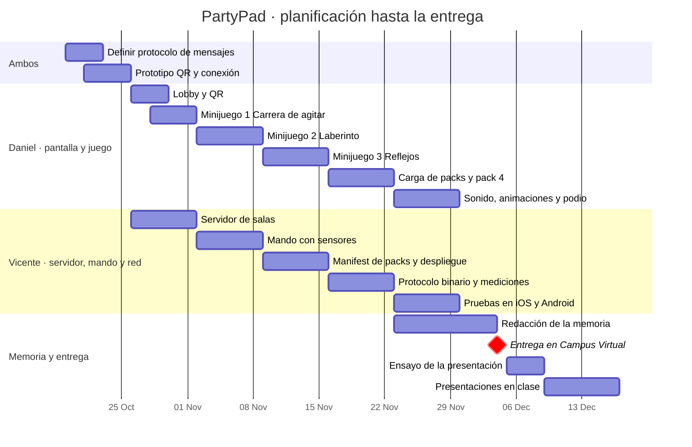

# 04 · Planificación y reparto

[← Volver al README](../README.md)

## Reparto del trabajo

Trabajamos por capas para poder avanzar en paralelo. El punto de unión es el **protocolo de mensajes**, que definimos juntos la primera semana y no cambiamos sin avisar al otro.

| Persona | Responsabilidad | Carpetas |
|---|---|---|
| **Daniel** | Pantalla y juego: lobby y QR, minijuegos en Phaser, sonido, animaciones, podio y carga de packs en el cliente | `host/`, `packs/` |
| **Vicente** | Servidor, mando y red: salas, mando con sensores, protocolo binario, mediciones de compresión, manifest de packs y despliegue | `server/`, `controller/`, `shared/` |
| **Ambos** | Protocolo de mensajes, pruebas con muchos móviles, memoria y presentación | `docs/` |

## Calendario

| Semana | Hito | Daniel | Vicente |
|---|---|---|---|
| 19–25 oct | **Prototipo:** QR, el móvil se conecta y un botón mueve algo en pantalla | Pantalla mínima con QR | Servidor mínimo con WebSocket |
| 26 oct–1 nov | Salas, lobby y minijuego 1 | Lobby y Carrera de agitar | Servidor de salas |
| 2–8 nov | Minijuego 2, vibración y puntuaciones | Laberinto | Mando con sensores y vibración |
| 9–15 nov | Minijuego 3, packs y despliegue | Reflejos | Manifest de packs y despliegue en la nube |
| 16–22 nov | Compresión y pack descargable | Carga de packs y Apunta y dispara | Protocolo binario y mediciones |
| 23–29 nov | Pruebas y pulido, empezar la memoria | Sonido, animaciones y podio | Pruebas en iOS y Android |
| 30 nov–4 dic | **Entrega** | Memoria | Memoria |
| 5–8 dic | Ensayo de la presentación | Ambos | Ambos |
| 9–16 dic | **Presentaciones en clase** | | |

La idea es tener algo jugable desde la segunda semana. A partir de ahí todo lo que se añade es mejora, no riesgo.

## Forma de trabajar con Git

- **`main`** siempre funciona.
- Cada tarea va en su rama: `feature/lobby`, `feature/tilt-maze`, `feature/protocolo-binario`…
- Sin pull requests: al ser un equipo de dos, se trabaja con **commits** en la rama y se fusiona en `main` cuando la tarea funciona.
- Las tareas se apuntan como **issues** de GitHub, con la etiqueta `daniel` o `vicente` y el hito de la semana.
- Mensajes de commit cortos y en español: `Añade lobby con QR`, `Corrige reconexión del mando`.

## Riesgos y cómo los cubrimos

| Riesgo | Impacto | Plan |
|---|---|---|
| iOS pide permiso explícito para los sensores | El mando no responde en iPhone | Llamar a `DeviceMotionEvent.requestPermission()` tras pulsar un botón "Empezar" en el mando |
| iOS Safari no soporta vibración | Se pierde el aviso | Detectarlo y usar un destello en la pantalla del móvil |
| Los sensores solo funcionan con HTTPS | El mando no lee nada en local | Desplegar pronto en la nube, o usar un túnel HTTPS para pruebas locales |
| La wifi de la universidad aísla dispositivos | Los móviles no ven al PC | Servidor en la nube: todos se conectan por internet |
| Latencia alta en la demo | El juego da tirones | Interpolar en la pantalla y probar en la red de la universidad antes |
| Demasiados jugadores en la demo | Se satura la sala | Límite de 8 por sala y modo espectador para el resto |
| Se nos echa el tiempo encima | No llegamos a todo | Prioridad: 3 minijuegos funcionando y compresión medida. El pack descargable y el pulido van después |

## Checklist antes de entregar

- [ ] Los tres minijuegos base se pueden jugar de principio a fin
- [ ] El pack descargable se instala desde el servidor
- [ ] Probado en al menos un iPhone y un Android
- [ ] Desplegado en la nube con HTTPS y URL pública
- [ ] Mediciones de compresión hechas y en la memoria
- [ ] README con instrucciones de ejecución actualizadas
- [ ] Memoria en PDF de 12 páginas como máximo
- [ ] ZIP con el nombre correcto subido a Campus Virtual por uno de los dos
